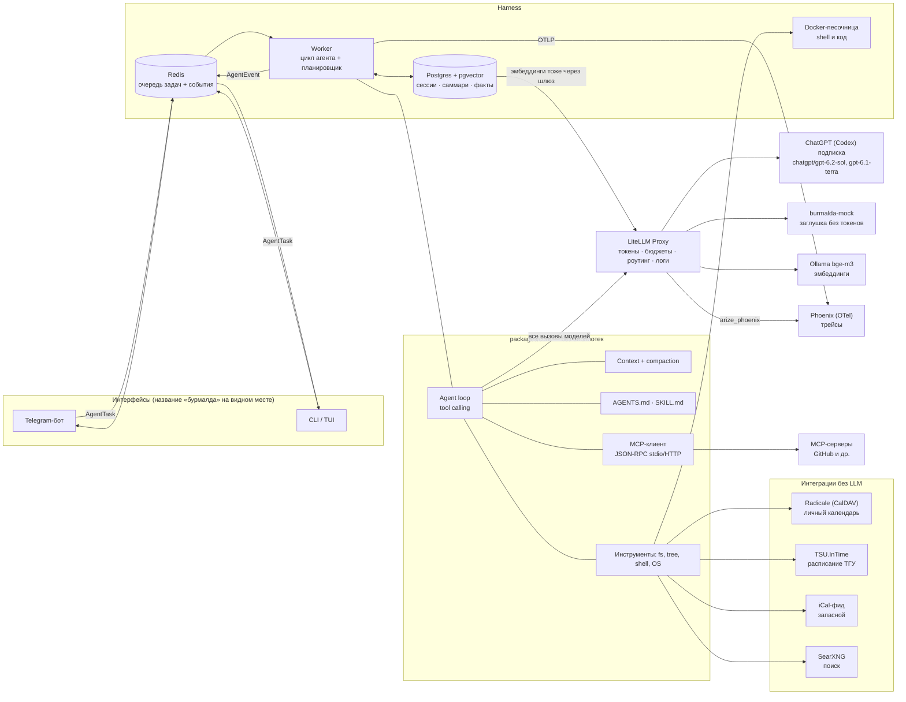

# План: «бурмалда»

Команда из двух человек: **участник A** и **участник B**. Задача — все 60 баллов задания и бонус за поиск товаров по маркетплейсам (до 5 баллов).

Работа разделена по одному признаку: **A делает всё, что вызывает модель и тратит токены; B — всё, что работает без модели.**
Так у B не нужна подписка на LLM: свою часть он тестирует на сценарном `FakeLlmClient` и на модели-заглушке `burmalda-mock` в шлюзе.

## Архитектура

Ключевые решения:

- **Цикл агента крутится только в worker.** Интерфейсы кладут `AgentTask` в очередь и слушают `events:<sessionId>`.
  Сессия принадлежит владельцу, а не каналу, поэтому начатое в Telegram продолжается в CLI.
- **Ядро без библиотек** (`packages/core`): свой HTTP-клиент шлюза на `fetch`, свои типы сообщений, свой MCP-клиент.
  Запрет внешних импортов в ядре проверяет ESLint. Библиотеки допустимы только в harness: telegraf, bullmq, pg, pino.
- **MCP-клиент пишем сами**, официальный SDK не берём: подключение к MCP — критерий ядра, и «без библиотек» трактуем строго.
  Протокол небольшой: `initialize` → `tools/list` → `tools/call`, транспорты stdio и Streamable HTTP.
- **Шлюз LiteLLM**: приложение знает только алиасы `burmalda-main / -fast / -embed / -mock`. Провайдеры, резерв, бюджеты и лимиты — в `infra/litellm/config.yaml`.
- **Наблюдаемость — Phoenix**, а не Langfuse: один контейнер, OTLP из коробки, LiteLLM пишет туда штатным колбэком `arize_phoenix`.
  Langfuse v3 тянет ClickHouse и MinIO. Дашборд расхода — LiteLLM Admin UI (расход по ключам, моделям, дням) и токены в Phoenix.
- **Интеграции — обычные API-клиенты** в `packages/integrations`, без LLM. Инструменты агента — тонкие обёртки над ними.

## Шлюз и подписка ChatGPT (Codex)

- LiteLLM ходит в модели по подписке ChatGPT: провайдер `chatgpt/`, вход по коду устройства, токены в `auth.json`,
  эндпоинты `/responses` и `/chat/completions` (мост в Responses). https://docs.litellm.ai/docs/providers/chatgpt
- Шлюз не умеет войти сам, поэтому логинимся заранее (README). `auth.json` должен быть доступен на запись: шлюз обновляет токены.
  `max_tokens` и `metadata` бэкенд не принимает, LiteLLM их срезает. У моделей подписки нет цены, поэтому расход считается как $0 и `max_budget` не срабатывает.
  Чтобы бюджеты и дашборд работали, в конфиге заданы **условные цены** за токен. Дополнительно — `rpm_limit/tpm_limit` на ключ.
- Логин шлюза **отдельный** от `~/.codex/auth.json`: refresh-токен одноразовый, общий файл сломал бы Codex CLI.
- Условия OpenAI (https://openai.com/policies/sign-in-with-chatgpt-terms/) запрещают использовать подписку одного человека для запросов другого.
  Подписка подключается только на машине A. B работает без неё: `burmalda-mock` в шлюзе и `FakeLlmClient` в тестах.
- Резерв за тем же шлюзом — OpenRouter или OpenAI API. В конфиге закомментирован, необязателен, платный.
- Эмбеддинги подписка не даёт, поэтому стоит локальная Ollama `bge-m3` (мультиязычная, 1024 измерения), тоже через шлюз как `burmalda-embed`.
- **Проверить первым делом**: доходит ли tool calling через мост chat/completions → Responses для `chatgpt/` (формат `tool_calls`, параллельные вызовы).
  Если нет, клиент ядра переходит на `/v1/responses` через тот же шлюз.

## Тесты без токенов

- `FakeLlmClient` (`packages/core/src/llm/fakeClient.ts`) — сценарий ответов модели: текст или заданные `tool_calls`.
  На нём проверяются цикл, реестр инструментов, подтверждения, очередь, интерфейсы и навыки без единого обращения к модели.
- `burmalda-mock` в шлюзе — LiteLLM отвечает фиксированным текстом (`mock_response`) и не ходит к провайдеру.
  Нужна для сквозной проверки CLI → очередь → worker → шлюз → интерфейс и для CI. В `.env` у B: `BURMALDA_MODEL_MAIN=burmalda-mock`.
- Реальные модели гоняет только A, и только там, где без них не проверить: качество ответов, compaction, извлечение фактов.

## Карта модулей ↔ критерии

| Критерий                                                              | Баллы | Где                                                      |                          Кто                           |
| --------------------------------------------------------------------- | ----: | -------------------------------------------------------- | :----------------------------------------------------: |
| **Ядро (30)**                                                         |       |                                                          |                                                        |
| ФС: чтение/правка, AGENTS.md, SKILL.md, иерархическое дерево каталога |     5 | `core/tools/fs`, `core/instructions`, `core/skills`      |                           B                            |
| Подключение к LLM-шлюзу                                               |     5 | `core/llm/gatewayClient.ts`                              |                           A                            |
| Подключение к MCP-серверам                                            |     5 | `core/mcp` (stdio + HTTP)                                |                           A                            |
| Shell и нативные инструменты ОС: pwsh 7, Linux, macOS                 |     5 | `sandbox` (host-адаптеры), `core/tools/os`, CI на 3 ОС   |                           B                            |
| Пользовательский интерфейс                                            |     5 | `apps/cli` (TUI)                                         |                           B                            |
| Context window и compaction                                           |     5 | `core/context`                                           |                           A                            |
| **Harness (20)**                                                      |       |                                                          |                                                        |
| LLM-шлюз LiteLLM: токены, бюджеты, роутинг, логи                      |     4 | `infra/litellm`, ключи с бюджетом                        |                           A                            |
| Память: краткосрочная + долговременная (вектор + не только)           |     4 | `packages/memory`                                        |                           A                            |
| Интерфейсы: Telegram + CLI, общая память и очередь                    |     4 | `apps/telegram`, `apps/cli`, `packages/queue`            |                           B                            |
| Песочница: Docker для shell и кода                                    |     4 | `packages/sandbox`, `infra/sandbox`                      |                           B                            |
| Наблюдаемость: JSON-логи, трейсы, дашборд расхода                     |     4 | pino, OTel → Phoenix, LiteLLM UI                         | A (LLM-трейсы, расход), B (логи и спаны своих модулей) |
| **Функциональность (10)**                                             |       |                                                          |                                                        |
| Поиск в интернете                                                     |     1 | SearXNG в compose → `web_search`, `fetch_url`            |                           B                            |
| Напоминания по расписанию                                             |     1 | BullMQ delayed/repeat jobs в worker → Telegram/CLI       |                           B                            |
| Личный календарь                                                      |     1 | Radicale (CalDAV) в compose + CalDAV-клиент              |                           B                            |
| Внешний календарь (чтение)                                            |     1 | TSU.InTime (расписание ТГУ), запасной — iCal-фид         |                           B                            |
| GitHub                                                                |     1 | GitHub MCP-сервер через наш MCP-клиент                   |           B (конфиг сервера), A (MCP-клиент)           |
| Бонус: поиск товаров по нескольким маркетплейсам                      |  до 5 | `integrations/marketplaces`, `skills/marketplace-search` |          B (адаптеры), A (навык и инструмент)          |

Задача, которая требует модели (системный промпт, выбор инструментов, проверка на живой модели), всегда у A. API-клиент, парсер, хранилище и инструмент вокруг них — у B.

## Внешний календарь: TSU.InTime

Публичный API без ключа, проверен запросами 24.11.2026. Документированного контракта нет, поэтому парсим осторожно:

| Запрос                                                                    | Ответ                                                                                                                   |
| ------------------------------------------------------------------------- | ----------------------------------------------------------------------------------------------------------------------- |
| `GET https://intime.tsu.ru/api/web/v1/faculties`                          | `[{ id, name, … }]`                                                                                                     |
| `GET …/faculties/{facultyId}/groups`                                      | `[{ id, name, isSubgroup, facultyId }]`                                                                                 |
| `GET …/schedule/group?id={groupId}&dateFrom=YYYY-MM-DD&dateTo=YYYY-MM-DD` | `{ grid: [{ date, lessons: [{ type: "LESSON"\|"EMPTY", title, lessonType, starts, ends, professor, audience }] }], … }` |

`starts`/`ends` — секунды от полуночи UTC: 6300 — это 01:45 UTC, то есть 08:45 по Томску.
Адаптер `InTimeSource` (`packages/integrations/src/calendar/intime.ts`) уже написан: `INTIME_GROUP_ID` в `.env`, группа выбирается через `listFaculties` и `listGroups`.

Группы (НОЦ «Высшая ИТ школа», факультет `aa30cf34-6279-11e9-8107-005056bc52bb`):

| Группа                                    | `INTIME_GROUP_ID`                      | Проверка 23–29.11.2026 |
| ----------------------------------------- | -------------------------------------- | ---------------------- |
| 972302 (A, по умолчанию в `.env.example`) | `ac6b8bef-2c83-11ee-8151-005056bc52bb` | 14 занятий             |
| 972303 (B)                                | `b344e210-2c83-11ee-8151-005056bc52bb` | 12 занятий             |

## Маркетплейсы (бонус)

Площадки: **Ozon, Wildberries, Яндекс Маркет**.

Что выяснили:

- Официального API поиска по каталогу для покупателей нет ни у одной из трёх. API WB, Ozon Seller и Маркета для продавцов
  управляют своими товарами и заказами, чужой каталог не ищут. В API реферальной программы Маркета `GET /search` убран 22.06.2026
  (https://yandex.ru/support/market-distr/ru/api/concepts/changelog). У Ozon Blogger API нет.
- Простые HTTP-запросы к поиску закрыты антиботом (проверено 24.11.2026 с томского IP): `search.wb.ru` → 403, ozon.ru → 307, market.yandex.ru → 302 на капчу.
- Готовый легальный агрегатор — Market Ninja API (https://www.marketninja.ru/docs/api/overview): Ozon, WB, Маркет, Lamoda, только чтение, ключ на платном тарифе Premium. Решение 25.11: не используем.
  Минус: данные собирает их расширение, поэтому свежих и редких товаров может не быть.

Решение:

- Адаптеры за интерфейсом `MarketplaceAdapter` (`packages/integrations/src/marketplaces`), по одному на площадку, плюс `searchAll`:
  параллельный поиск, недоступная площадка не роняет остальные.
- Основной способ чтения — headless-браузер (Playwright) в песочнице: открыть публичную страницу поиска без входа в аккаунт,
  достать карточки из DOM или встроенного JSON. Один запрос на площадку, паузы, кэш на 15 минут.
- На капче или блокировке адаптер останавливается с `MarketplaceBlockedError`. Обходить защиту (решатели капч, ротация прокси) не будем:
  это прямое нарушение правил площадок.
- Сделано (A): сервис `infra/browser` (Playwright/Chromium headless, изолированный контейнер, allowlist доменов,
  лимит частоты) и адаптеры всех трёх площадок поверх него. Stealth-плагины и подмену отпечатков не используем.
  Живая проверка 24.11.2026: Маркет — 403 по IP, Ozon — антибот (403, `__rr=1`), WB — антибот (498); адаптеры
  останавливаются с `MarketplaceBlockedError`. Подробности — docs/AUDIT.md.
- Без токенов (B): адаптеры, парсеры, нормализация в `ProductOffer`, тесты на сохранённых HTML/JSON.
  С токенами (A): инструмент `marketplace_search`, навык `skills/marketplace-search/SKILL.md` (разбор запроса, отбор, сравнение), проверка на живой модели.

Риски: пользовательские соглашения площадок запрещают автоматический сбор данных. Здесь это личное использование с единичными запросами
и без обхода защиты, но вёрстка и антибот меняются без предупреждения, поэтому бонус делаем последним и демо записываем заранее.
Запасной источник — `IcsSource`, любой публичный iCal-фид, например расписание турниров (`EXTERNAL_CALENDAR_SOURCE=ics`).
Оба реализуют `ExternalScheduleSource`, поэтому инструмент `schedule` от источника не зависит.

## Как устроено ядро

- **Цикл** (`runAgent`): модель → `tool_calls` → выполнение → `tool`-сообщения → снова модель, пока нет финального ответа или лимита шагов.
  Опасные инструменты (`dangerous`) ждут подтверждения владельца через событие `approval_required`: кнопки в Telegram, y/N в CLI.
- **System prompt** собирается так: базовая роль → цепочка AGENTS.md от корня workspace к cwd → список скиллов (только name и description)
  → релевантные факты из долговременной памяти. Тело SKILL.md подгружает инструмент `load_skill`.
- **Инструменты ФС**: `read_file` (диапазон строк), `write_file`, `edit_file` (точечная замена с проверкой уникальности), `list_dir`
  (дерево с глубиной, учёт .gitignore), `search_files`. Всё в пределах workspace, выход за него — `dangerous`.
- **Shell**: по умолчанию `docker exec` в контейнер сессии (`--network none`, read-only rootfs, cap-drop ALL, лимиты CPU/RAM/PID).
  Host-режим: Windows → `pwsh -NoProfile -Command` (версия ≥ 7), macOS → zsh, Linux → bash. Плюс `os_info`, `list_processes`, `open_url`.
- **Compaction**: точный размер берётся из `usage.prompt_tokens` последнего ответа шлюза, между ответами — оценка. На 70% окна старые шаги
  заменяются саммари (`burmalda-fast`). Остаются system, последние N сообщений и целые пары tool_call/tool. Большие выводы инструментов урезаются сразу.
  Саммари сохраняется в память, поэтому сессия переживает перезапуск и смену канала.
- **Память**: `messages` (сессия, канал, JSON сообщения), `summaries`, `facts` (текст, теги, `vector(1024)`, `tsvector`), `profile` (ключ-значение).
  `recall` объединяет косинус pgvector и полнотекстовый поиск через RRF. Факты пишут инструмент `remember` и фоновое извлечение после задачи.

## Порядок работ

Этапы идут по зависимостям: следующий этап опирается на результат предыдущего. Внутри этапа A и B работают параллельно.
Общие контракты — `packages/shared/src/types.ts`, `core/tools/types.ts`, `integrations/calendar/types.ts`. Меняются только по договорённости.

### Этап 1. Фундамент

| A                                                                                                     | B                                                                                                              |
| ----------------------------------------------------------------------------------------------------- | -------------------------------------------------------------------------------------------------------------- |
| OrbStack, `infra:up`, вход ChatGPT в LiteLLM, ключ с бюджетом. Проверка tool calling через `chatgpt/` | `infra:up` с `burmalda-mock`, CI на 3 ОС, тесты на `FakeLlmClient`                                             |
| Цикл агента: ошибки шлюза, ретраи, лимит шагов, отмена, события                                       | Инструменты ФС: `read_file`, `write_file`, `edit_file`, `search_files`, `list_dir` (дерево), границы workspace |
| Трейсы шлюза в Phoenix, OTel-спаны цикла                                                              | AGENTS.md (иерархия) и SKILL.md (frontmatter, `load_skill`)                                                    |

Результат: `pnpm dev:cli -- --direct` на живой модели читает и правит файлы, видит AGENTS.md и скиллы, трейс виден в Phoenix.

### Этап 2. Исполнение и каналы

| A                                                                    | B                                                                                   |
| -------------------------------------------------------------------- | ----------------------------------------------------------------------------------- |
| MCP-клиент: JSON-RPC, stdio и Streamable HTTP, `tools/list` → реестр | Песочница: образ, контейнер на сессию, `docker exec`, таймауты, лимиты              |
| Краткосрочная память: миграции, сессии, общие для каналов            | Host-shell: pwsh 7 / bash / zsh, подтверждение, тесты адаптеров в CI                |
| Compaction: порог, саммари, целостность tool-пар, запись в память    | Очередь и worker на BullMQ, CLI в режиме очереди, Telegram с кнопками подтверждения |
|                                                                      | Конфиг GitHub MCP-сервера, проверка через MCP-клиент A                              |

Результат: задача, начатая в Telegram, продолжается в CLI. Shell работает в песочнице, GitHub подключён через MCP.

### Этап 3. Навыки и память

| A                                                                                               | B                                                                              |
| ----------------------------------------------------------------------------------------------- | ------------------------------------------------------------------------------ |
| Долговременная память: эмбеддинги через шлюз, гибридный `recall`, `remember`, извлечение фактов | Поиск: SearXNG в compose, `web_search`, `fetch_url`                            |
| Системный промпт и описания инструментов для навыков, проверка на живой модели                  | Напоминания: delayed/repeat jobs → Telegram/CLI                                |
| Бюджеты и лимиты на ключи, дашборд расхода                                                      | Radicale + CalDAV-клиент (личный календарь); InTime и iCal (внешний календарь) |

Результат: все критерии работают от начала до конца.

### Этап 4. Доводка

- Нагрузочная проверка compaction на длинной сессии, резерв в шлюзе (A).
- Маркетплейсы: адаптеры Ozon, WB и Маркета, тесты на сохранённых страницах (B); инструмент `marketplace_search` и навык (A).
- Перекрёстное ревью, исправление багов, два прогона демо, запись видео на всякий случай, артефакты для сдачи.

## Сценарий демо (≈10 минут)

1. `docker compose ps` — шлюз, Postgres+pgvector, Redis, Phoenix, Ollama, Radicale. LiteLLM UI: модели `burmalda-*`, ключ с бюджетом.
2. CLI (баннер «бурмалда»): «Покажи структуру проекта и что сказано в AGENTS.md» → `list_dir`, чтение AGENTS.md. «Добавь в README раздел …» → `edit_file`.
3. «Запусти тесты» → shell в песочнице. Показать `docker ps` с контейнером сессии: `rm -rf /` там ничего не ломает. Host-режим: pwsh 7 (CI на Windows) / zsh.
4. Скилл: «сделай ревью этого файла по нашему скиллу» → агент находит SKILL.md и подгружает его.
5. MCP: «какие открытые issues в нашем репо?» → GitHub MCP-сервер.
6. Telegram: «напомни через 2 минуты выпить воды», «какие у меня завтра пары?» (InTime), «запиши встречу на пятницу в 15:00» (Radicale),
   «найди в интернете …». Через 2 минуты приходит напоминание.
7. Смена канала: начать задачу в Telegram, продолжить в CLI с тем же контекстом.
8. Память: «запомни, что я пью кофе без сахара» → новая сессия → «какой кофе я пью?». Показать таблицу facts с векторами.
9. Compaction: длинная сессия → в логах событие compaction, размер контекста до и после.
10. Маркетплейсы: «найди беспроводные наушники до 5000 ₽» → сравнительная таблица с Ozon, WB и Маркета.
11. Наблюдаемость: трейс задачи в Phoenix (цикл → вызовы модели → инструменты), расход в LiteLLM UI, JSON-логи.

## Риски

| Риск                                                     | Что делаем                                                                                                          |
| -------------------------------------------------------- | ------------------------------------------------------------------------------------------------------------------- |
| Tool calling через мост `chatgpt/` работает не полностью | Проверка на этапе 1; запасной путь — клиент на `/v1/responses` через тот же шлюз                                    |
| Лимиты подписки ChatGPT                                  | Разработка и тесты на `burmalda-mock` и `FakeLlmClient`; на живой модели — `burmalda-fast` и rpm/tpm-лимиты на ключ |
| InTime поменяет API (контракта нет)                      | Адаптер за интерфейсом `ExternalScheduleSource`, понятные ошибки, запасной iCal-источник                            |
| Нет Windows для проверки pwsh 7                          | CI в GitHub Actions на windows-latest и юнит-тесты host-адаптера                                                    |
| Ollama в контейнере на Mac без GPU                       | bge-m3 на CPU для эмбеддингов хватает; запасной вариант — Ollama нативно на хосте                                   |
| Спорная трактовка «без библиотек»                        | Ядро вообще без зависимостей (проверяет ESLint), библиотеки только в harness — объяснить на защите                  |
| Маркетплейсы закрывают доступ капчей                     | Адаптер останавливается и честно сообщает; запасного источника нет (Market Ninja отклонён); демо записываем заранее |
| Не хватает времени                                       | Приоритет: ядро 30 → harness 20 → навыки 10 → бонус. Бонус режем первым                                             |
